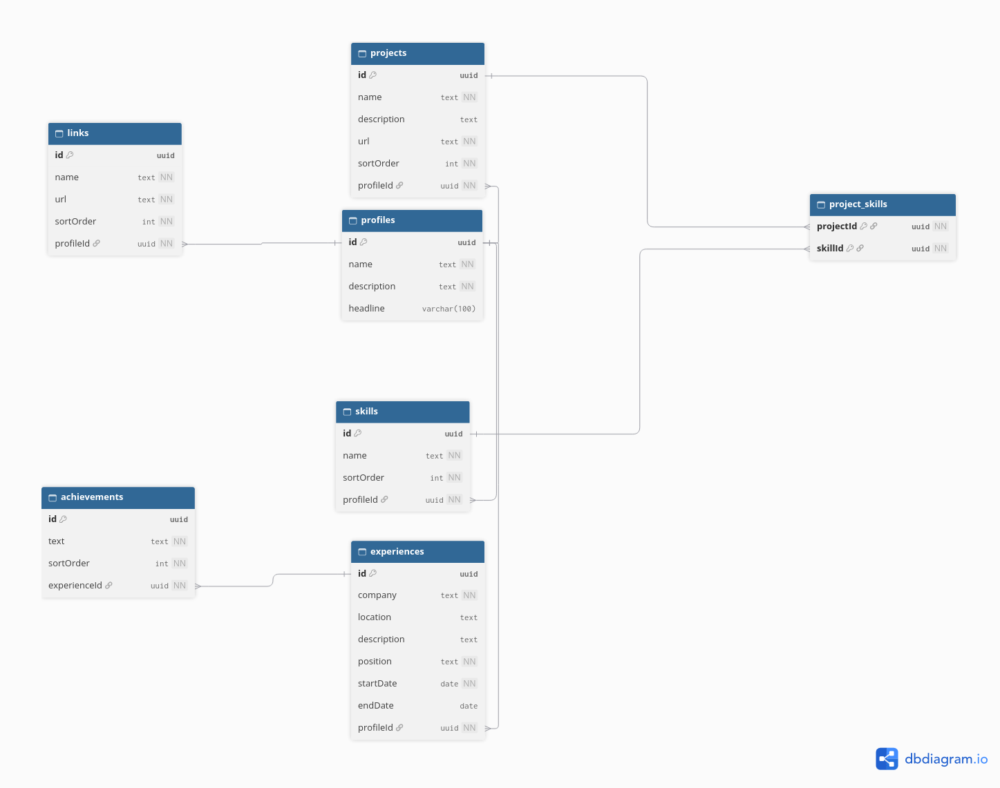

# Цифровая визитка: GraphQL API

Backend-приложение, которое отдаёт через GraphQL информацию обо мне: профиль, ссылки, навыки, опыт работы с достижениями и проекты со стеком.

- **Исходный код:** https://github.com/ninq4/test-card
- **Apollo Sandbox:** <!-- TODO: ссылка на задеплоенный /graphql -->

## Стек

| Задача | Технология |
|---|---|
| Язык и рантайм | TypeScript 6, Node.js 22+ |
| Фреймворк | NestJS 12 |
| API | GraphQL (code-first), Apollo Server 5, Apollo Sandbox |
| База данных | PostgreSQL 17 |
| ORM и миграции | Prisma 7 (driver adapter `@prisma/adapter-pg`) |
| Валидация конфигурации | class-validator, class-transformer |
| Инфраструктура | Docker, Docker Compose |

## Быстрый старт

Требования: Node.js 22.22+ (или 24+), npm, Docker с Docker Compose.

```bash
npm ci
cp .env.example .env

docker compose up -d          # PostgreSQL
npx prisma generate           # клиент Prisma в src/generated/prisma
npx prisma migrate deploy     # схема БД
npx prisma db seed            # данные визитки

npm run start:dev
```

Apollo Sandbox откроется по адресу `http://localhost:3001/graphql` (порт задаётся переменной `PORT`).

## Примеры запросов

Запрос из задания выполняется без изменений:

```graphql
query {
  profile {
    name
    description
    skills {
      name
    }
    experience {
      company
      position
    }
    projects {
      name
    }
  }
}
```

Все данные визитки:

```graphql
query {
  profile {
    id
    name
    headline
    description
    links {
      name
      url
    }
    skills {
      name
    }
    experience {
      company
      position
      location
      description
      startDate
      endDate
      achievements {
        text
      }
    }
    projects {
      name
      url
      description
      skills {
        name
      }
    }
  }
}
```

Если `endDate` равен `null`, значит, я работаю там по настоящее время. Даты отдаются собственным скаляром `Date` в формате `YYYY-MM-DD`.

## Архитектура

Приложение разделено на три слоя. Зависимости направлены только сверху вниз:

```
api  ──►  modules  ──►  infrastructure
```

| Слой | Папка | Ответственность |
|---|---|---|
| API | `src/api` | GraphQL: резолверы, модели (`@ObjectType`), мапперы, скаляры. Ничего не знает о Prisma |
| Бизнес-логика и данные | `src/modules` | Модули фич: сервис (правила, доменные ошибки) и репозиторий (единственное место, где вызывается Prisma). Ничего не знает о GraphQL |
| Инфраструктура | `src/infrastructure` | Подключение к БД (`PrismaService`), глобальный фильтр ошибок |

```
src/
├── api/
│   ├── api.module.ts              # GraphQLModule, резолверы
│   └── graphql/
│       ├── profile/               # Query.profile + поля links, skills, experience, projects
│       ├── experience/            # Experience.achievements
│       ├── project/               # Project.skills
│       ├── link/  skill/          # модели и мапперы
│       └── scalars/               # скаляр Date
├── modules/
│   ├── profile/  link/  skill/  experience/  project/
│   └── shared/exceptions/         # базовое ApplicationException
├── infrastructure/
│   ├── database/                  # PrismaModule (@Global), PrismaService
│   └── filters/                   # ApplicationException → GraphQLError / HTTP
├── config/                        # валидация переменных окружения
└── generated/prisma/              # сгенерированный клиент (не в git)
```

Как выполняется запрос:

1. **Резолвер** принимает GraphQL-запрос и вызывает сервис. Вложенные поля (`links`, `achievements`, `skills` проекта) описаны через `@ResolveField` и выполняются, только если клиент их запросил.
2. **Сервис** применяет бизнес-правила. Например, если профиля нет, он бросает доменное `ProfileNotFoundException`.
3. **Репозиторий** обращается к БД через Prisma и возвращает типы Prisma.
4. **Маппер** в слое API явно превращает тип Prisma в GraphQL-модель, поэтому изменение схемы БД не меняет публичный API само по себе.
5. **Фильтр ошибок** переводит доменное исключение в `GraphQLError` с машинным кодом в `extensions.code` (например, `PROFILE_NOT_FOUND`), а для HTTP-запросов возвращает JSON с соответствующим статусом.

## База данных



Исходник диаграммы лежит в [docs/schema.dbml](docs/schema.dbml), схема Prisma — в [prisma/schema.prisma](prisma/schema.prisma).

- `Profile` связан 1:N с `Link`, `Skill`, `Experience` и `Project`, а `Experience` связан 1:N с `Achievement`.
- Проекты и навыки связаны M:N через явную модель `ProjectSkill` с составным первичным ключом.
- Все внешние ключи проиндексированы и удаляются каскадом. Навык уникален в рамках профиля: `@@unique([profileId, name])`.
- Порядок вывода задаётся полем `sortOrder`, а опыт сортируется по `startDate` от новых к старым.

**Миграции** лежат в `prisma/migrations` и применяются командой `prisma migrate deploy`.

**Seed** ([prisma/seed.ts](prisma/seed.ts)) заполняет БД данными из [prisma/seed/data.ts](prisma/seed/data.ts):

- данные отделены от логики вставки и описаны вложенной структурой, удобной для чтения и правки;
- seed идемпотентен: удаление и вставка выполняются в одной транзакции, поэтому повторный запуск не создаёт дублей и применяет изменения из `data.ts`, а при ошибке старые данные остаются на месте;
- перед транзакцией данные проверяются: дубли навыков, неизвестные навыки в проектах, корректность дат.

## Вложенные данные и проблема N+1

Каждое вложенное поле резолвится отдельно, поэтому без пакетной загрузки число SQL-запросов растёт вместе с объёмом данных. Ниже замер на полном запросе: 2 места работы и 12 проектов, SQL взят из лога Prisma.

| Поле | Запросов без пакетной загрузки |
|---|---|
| `profile` | 1 |
| `links`, `skills`, `experience`, `projects` | 4 |
| `experience.achievements` | 2 (по одному на место работы) |
| `projects.skills` | 24 (по два на проект: `ProjectSkill` и `Skill`) |
| **Итого** | **31** |

<!-- TODO: решение через DataLoader и замер «после» -->

## Принятые решения

- **Разделение по слоям**, а не по фичам: структура папок повторяет три ответственности из задания (API, бизнес-логика, работа с данными).
- **Без CQRS**: API только читает данные, а записывает их один seed при старте. Разделять команды и запросы здесь нечего, и паттерн добавил бы лишние слои без пользы.
- **Явная модель `ProjectSkill`** вместо неявной M:N. К связующей таблице можно обратиться одним запросом по набору `projectId`, а это нужно для пакетной загрузки навыков проектов.
- **Batch-методы репозиториев** (`find…ByProfileIds(ids)`) с самого начала: один и тот же метод обслуживает и одиночный вызов, и пакетную загрузку.
- **UUID** в качестве первичных ключей.
- **Скаляр `Date`** вместо `DateTime`: в БД колонки типа `DATE`, время и часовой пояс для периода работы не имеют смысла.
- **Apollo Sandbox в любом окружении**, с `introspection: true` и плагином `LandingPageLocalDefault`. По умолчанию Apollo отключает их в production, а визитка должна открываться на публичном адресе. Стектрейсы при этом в ответы не попадают.
- **Проверка соединения с БД при старте** (`SELECT 1`). С driver adapter `$connect()` ленивый, а приложение должно падать сразу, если БД недоступна или `DATABASE_URL` неверный.

## Переменные окружения

| Переменная | Обязательна | По умолчанию | Описание |
|---|---|---|---|
| `DATABASE_URL` | да | — | строка подключения к PostgreSQL |
| `PORT` | нет | `3000` | порт HTTP-сервера |

Переменные проверяются при старте (`src/config/env.validation.ts`): если `DATABASE_URL` отсутствует или некорректен, приложение не запустится.

## Скрипты

| Команда | Что делает |
|---|---|
| `npm run start:dev` | запуск в режиме разработки с перезапуском при изменениях |
| `npm run build` | сборка в `dist/` |
| `npm run start:prod` | запуск собранного приложения |
| `npx prisma migrate deploy` | применить миграции |
| `npx prisma db seed` | заполнить БД данными визитки |
| `npm run lint` | ESLint с автоисправлением |
